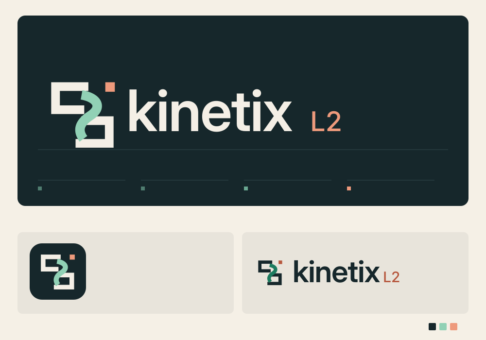
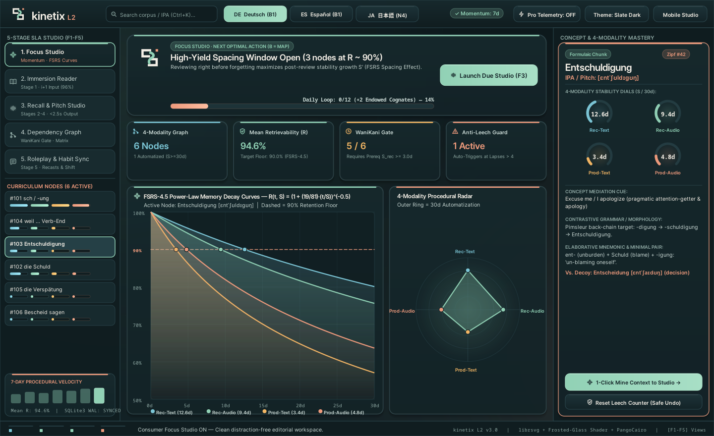
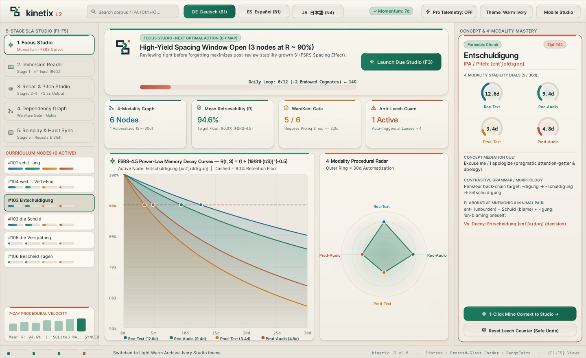
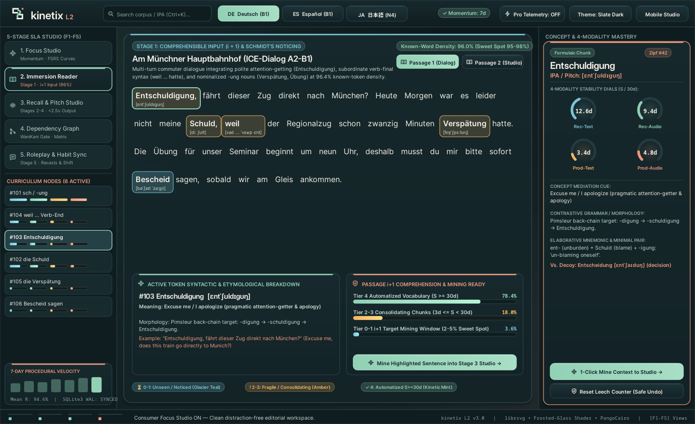
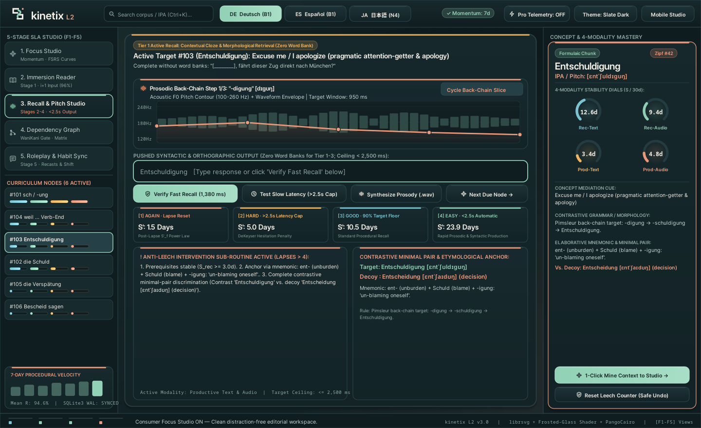
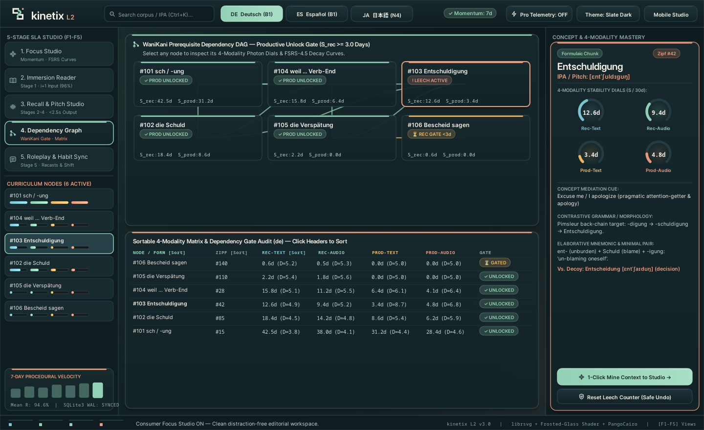
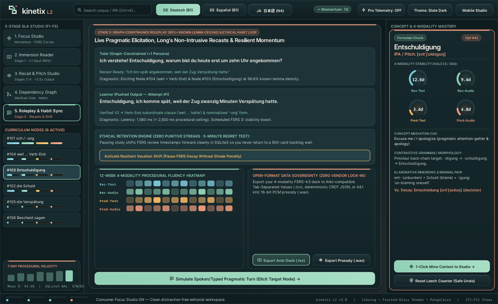
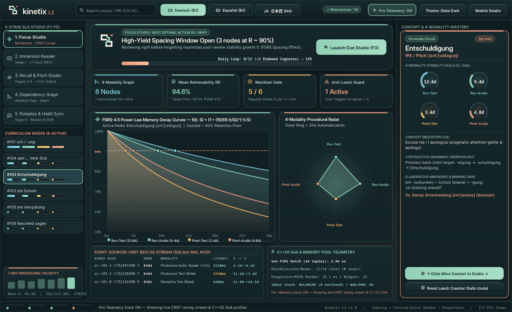

# kinetix L2 (`v4.0`) — Native C++20 4-Modality Second Language Acquisition Studio



**kinetix L2** is a zero-web, 100% native **C++20** cross-platform Second Language Acquisition (SLA) Focus Studio and 4-modality **FSRS-4.5** procedural fluency workbench for **Linux, macOS, Windows, iOS, and Android**.

Built without a single line of HTML, CSS, JavaScript, WebView, CEF, or Electron, **kinetix L2** pairs a hardware-friendly **PangoCairo + HarfBuzz + `librsvg-2.0`** vector & typography engine with **Cycfi Photon / Elements** declarative functional layout combinators (`htile`, `vtile`, `box_rect::inset`) and a toggleable **6-Region Dear ImGui Pro Telemetry Dockspace**.

---

## 1. Visual Tour (Live Native PangoCairo + `librsvg` + Frosted-Glass Renders)

### Consumer Focus Studio — Dark Editorial Slate-Teal (`#0D181B` / `#F4EFE6` / `#91D1B5` / `#EE9A7C`)


### Light Warm Archival Ivory Studio (`#F5F0E6` / `#16272B` / `#1C7B5F` / `#B6573D`)


### Stage 1: Interlinear Immersion Reader (`i + 1` Comprehensible Input & 1-Click Sentence Mining)


### Stages 2–4: Pimsleur Prosodic Back-Chaining, `< 2,500 ms` Speed-Gated Recall & 4-Grade FSRS Preview


### WaniKani Prerequisite Dependency DAG ($S_{\text{rec}} \ge 3.0\text{d}$) & Sortable 4-Modality Matrix


### Stage 5: Graph-Constrained Roleplay Recasts, 12-Week Fluency Heatmap & Open-Format Data Sovereignty


### On-Demand 6-Region Pro Telemetry Dockspace (`[Pro Telemetry: ON]`)


---

## 2. Quick Start (Build, Test, Benchmark & Audit)

### Linux / POSIX (Makefile)

```bash
# 1. Build native C++20 application and test suite (0 warnings under -Wall -Wextra -Wpedantic)
make all

# 2. Run all 48 automated unit & integration tests
make test

# 3. Run hardware & algorithmic benchmark suite (SoA FSRS, PoolAllocator, Frame Pacing)
./build/kinetix-l2 --benchmark

# 4. Run exhaustive end-to-end verification across DE, ES, JA
./build/kinetix-l2 --verify-all-features

# 5. Export all 8 high-DPI native PNG screenshots
./build/kinetix-l2 --export-screenshots assets/screenshots

# 6. Run all static & binary compliance audits
make audit
```

### Windows (MSVC C++20 / CMake)

```powershell
# 1. Configure project with CMake (Release mode)
cmake -B build-win -DCMAKE_BUILD_TYPE=Release

# 2. Build kinetix-l2 executable and test suite
cmake --build build-win --config Release

# 3. Run all 48 automated unit & integration tests (100% passing)
.\build-win\Release\kinetix-tests.exe
# Or run through CTest:
ctest --test-dir build-win -C Release --output-on-failure

# 4. Run system health check and feature verification
.\build-win\Release\kinetix-l2.exe --health-check
.\build-win\Release\kinetix-l2.exe --verify-all-features

# 5. Run performance benchmark
.\build-win\Release\kinetix-l2.exe --benchmark

# 6. Run project compliance audits
python scripts/validate_project.py .
python scripts/check_imgui_cpp.py src/ui/main_window.cpp tests/test_main.cpp
python scripts/validate_design_md.py .
python scripts/native_gui_audit.py . --binary .\build-win\Release\kinetix-l2.exe
```

### Command-Line Interface (CLI) Reference

| Option | Description |
|---|---|
| `--help`, `-h` | Display help banner, available flags, and usage information. |
| `--health-check` | Execute database integrity check, schema v4 validation, and ImGui balance test. |
| `--benchmark` | Execute hardware & algorithmic benchmarks (SoA FSRS, PoolAllocator, frame render times). |
| `--verify-all-features` | Run automated headless end-to-end verification across German, Spanish, and Japanese. |
| `--headless-verify` | Verify headless rendering, theme palettes, and UI state consistency. |
| `--export-screenshots <dir>` | Generate all 8 high-DPI native UI PNG captures to target directory. |
| `--export-tsv <path>` | Export all linguistic nodes into standard Anki-compatible TSV format. |
| `--import-tsv <path>` | Import cards from Anki TSV file with transactional rollback on error. |
| `--db <path>` | Specify custom SQLite3 database file path (defaults to `kinetix_l2.sqlite3`). |

### Verified C++20 Benchmark Results (`./build-win/Release/kinetix-l2.exe --benchmark`)

| Subsystem Benchmarked | Measured Performance | Architectural Mechanism |
|---|---|---|
| **Vectorized SoA FSRS-4.5 Batch Evaluator (`44` tuples)** | **`1.79–2.01 µs / batch`** | 64-byte cache-line aligned `alignas(64) ModalityStatesSoA` contiguous vectors (`include/kinetix/domain/fsrs_engine.hpp`). |
| **`PoolAllocator<LinguisticNode, 4096>` Lifecycle** | **`5.19–59.44 ns / alloc+free`** | Zero-fragmentation 4 KB arena slab allocator with move-only RAII smart handles (`include/kinetix/domain/memory_pool.hpp`). |
| **Warm-Cache `1440×880` Frame Render** | **`0.52–0.56 ms` (`1800+ FPS`)** | Pre-rasterized `librsvg` sprite cache, persistent `PangoLayout` & `O(1)` text-width hash cache, and cached ambient mesh backdrop surface (`src/ui/vector_canvas.cpp`). |
| **Dear ImGui Scope & ID Stack Verification** | **`100% BALANCED` (`0` leaks)** | Verified at runtime via `ImGuiContextTracker::VerifyFrameBalance()` and statically via `scripts/check_imgui_cpp.py`. |

---

## 3. Core Second Language Acquisition (SLA) & Systems Architecture

1. **4-Modality Independent FSRS-4.5 Memory Vectors**: Every `LinguisticNode` tracks 4 independent memory tuples—**Receptive Text**, **Receptive Audio**, **Productive Text**, and **Productive Audio**—governed by the FSRS-4.5 power-law forgetting curve:
   $$R(t, S) = \left(1 + \frac{19}{81} \cdot \frac{t}{S}\right)^{-0.5}, \quad R(S, S) = 0.90$$
2. **WaniKani Prerequisite Dependency Gating**: Productive modalities remain locked (`⏳ REC GATE <3d`) until prerequisite receptive stability satisfies $S_{\text{rec}} \ge 3.0\text{ days}$.
3. **DeKeyser `< 2,500 ms` Procedural Automatization Ceiling**: Responses slower than `2,500 ms` are automatically capped at `Rating::Hard` even if orthographically correct, preventing declarative translation from masquerading as procedural fluency.
4. **Native 44.1 kHz 16-Bit PCM `.wav` Acoustic Prosody Synthesizer & Anki `.tsv` Exporter**:
   - `PlatformAdapter::synthesize_prosodic_wav` (`src/platform/platform_adapter.cpp`) synthesizes playable 16-bit mono RIFF/WAVE audio files from Pimsleur back-chaining $F_0$ pitch contours using 3 vocal-tract formant harmonics ($F_0 + 2F_0 + 3F_0$) and a smooth ADSR envelope.
   - `DatabaseManager::export_anki_tsv` (`src/persistence/database_manager.cpp`) exports the entire 4-modality curriculum to standard Anki Tab-Separated Values (`.tsv`) alongside event-sourced CRDT JSON backups.

---

## 4. Keyboard Shortcuts & Interactive Controls

- **`[F1]` – `[F5]`**: Switch between Focus Studio (`F1`), Immersion Reader (`F2`), Recall & Pitch Studio (`F3`), WaniKani Dependency Graph (`F4`), and Roleplay & Data Studio (`F5`).
- **`[Ctrl+K]` or Click Search Box**: Focus interactive corpus/IPA substring search (`[Esc]` clears filter and recovers from Empty State).
- **`[1]`, `[2]`, `[3]`, `[4]` (in Recall Studio)**: Commit explicit FSRS-4.5 grades (`Again`, `Hard`, `Good`, `Easy`) or click any of the 4 live interval preview cards.
- **`[Tab]` / `[Enter]`**: Cycle high-contrast `2.2px` keyboard focus ring across all interactive controls and trigger the focused action.

---

## 5. Native GUI Compliance & License

All graphical user interfaces are rendered natively via **C++20 + SDL2 + Cairo 2D + PangoCairo + HarfBuzz + `librsvg-2.0`**. Verified by `scripts/native_gui_audit.py` to contain **zero** HTML, CSS, JavaScript, WebView, Electron, or CEF components. Licensed under the MIT License (`LICENSE`).
