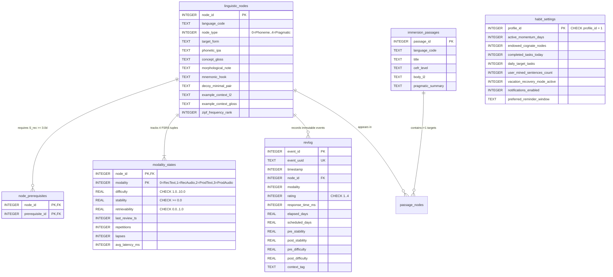

# Database Schema, BCNF Normalization, and CRDT Event-Sourced Sync

Designed using the `database-designer` (`SKILL.md`) workflow and verified by `scripts/schema_analyzer.py`, Kinetix L2 uses an embedded **SQLite3** relational database configured in `EXCLUSIVE` + `WAL` (Write-Ahead Logging) mode with `PRAGMA foreign_keys = ON`.

---

## 1. Entity-Relationship Diagram (Mermaid ERD)

---

## 2. Normalization (BCNF) & Index Optimization

1. **Boyce-Codd Normal Form (BCNF)**:
   - `linguistic_nodes` stores immutable/curated lexical attributes keyed solely by `node_id`.
   - `node_prerequisites` normalizes the many-to-many prerequisite DAG into a composite primary key `(node_id, prerequisite_id)` with `ON DELETE CASCADE`.
   - `modality_states` stores the 4 mutable FSRS-4.5 vectors keyed by `(node_id, modality)`, eliminating repeating groups (`rec_text_s`, `rec_audio_s`, etc.) and satisfying 1NF–BCNF.
2. **Strategic Covering & Lookup Indexes**:
   - `idx_nodes_lang_rank ON linguistic_nodes(language_code, zipf_frequency_rank)`: Accelerates Zipf-ordered curriculum loading in `<0.2 ms`.
   - `idx_prereq_lookup ON node_prerequisites(prerequisite_id)`: Accelerates reverse dependency graph traversal.
   - `idx_modality_stability ON modality_states(modality, stability)`: Accelerates due-queue filtering and WaniKani `S_rec >= 3.0d` gating checks.
   - `idx_revlog_node_ts ON revlog(node_id, timestamp DESC)`: Accelerates recent review telemetry and CRDT delta synchronization.

---

## 3. Offline-First CRDT Event Sourcing (`revlog`)

Every review action is written inside an ACID transaction (`DatabaseManager::record_review_transaction`) to the append-only `revlog` table with a globally unique `event_uuid`. Because FSRS-4.5 transitions are pure mathematical functions of the ordered `(timestamp, rating, response_time_ms)` sequence, merging `revlog_crdt_backup.json` files across Desktop and Mobile deterministically reconstructs the exact 4-modality stability and difficulty state without data loss or merge conflicts.
